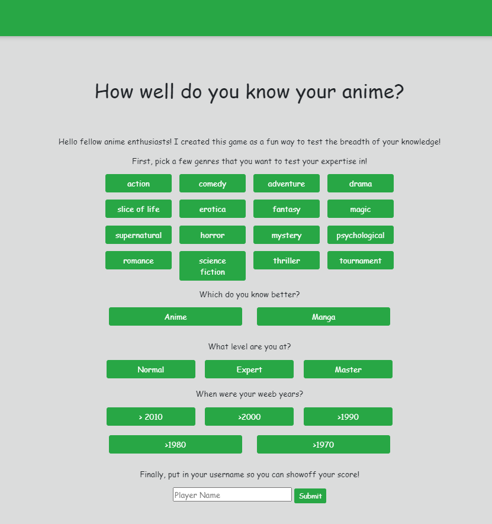
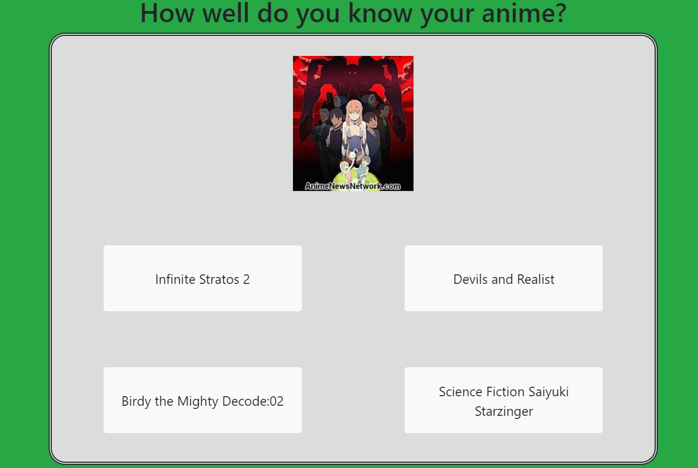

# Anime-Game
A quiz game for anime and manga fans. Pick genres, anime and/or manga, a difficulty and the decades you know best, then name the title from its picture (or its plot summary) in 10 multiple-choice questions. Scores go on a shared scoreboard.

All title information comes from the [AnimeNewsNetwork](https://www.animenewsnetwork.com/) encyclopedia API, copied into MongoDB by a scraper script.




## Setup

You need **Node.js 20.19 or newer** and a **MongoDB** database: either MongoDB Community Server on your own computer, or a free MongoDB Atlas cluster.

1. Install the packages:
   ```
   npm install
   ```
2. Copy `.env.example` to `.env` and fill it in:
   - `MONGODB_URI`: where the database is. The default, `mongodb://127.0.0.1:27017/animeDB`, is a local MongoDB.
   - `SESSION_SECRET`: any long random string. You can generate one with `node -e "console.log(require('crypto').randomBytes(32).toString('hex'))"`.

   `.env` is git-ignored. Never put credentials in the code.
3. Fill the database from AnimeNewsNetwork:
   ```
   npm run scrape
   ```
   This asks for 50 titles per request, once a second (ANN's limit). It stops on its own at the end of the encyclopedia. You can stop it with Ctrl+C and run it again later; it resumes where it left off and never saves a title twice.
4. Start the game and open http://localhost:3000:
   ```
   npm start
   ```

If your database was filled by the 2020 version of the scraper, run `npm run migrate` once. It converts the old text fields to numbers and removes duplicate titles. The server prints a reminder at startup if it finds such data.

## Scripts

| Command | What it does |
|---|---|
| `npm start` | runs the game server |
| `npm run scrape` | adds titles from ANN (`-- --from 1 --to 5000` for a range) |
| `npm run migrate` | upgrades a database filled by the old scraper |
| `npm test` | runs the tests. Database tests run only with `TEST_MONGODB_URI` set to a throwaway database, which they wipe |

## How it works

| File | Role |
|---|---|
| `app.js` | Express server: settings form, questions, answers, scoreboard. Each player's game is kept in their own session, stored in MongoDB |
| `config.js` | reads settings from `.env` |
| `db.js` | the MongoDB connection and the Anime, Manga and Score models |
| `retrieve.js` | finds matching titles and builds the questions |
| `save-score.js` | saves scores and reads the top 10 |
| `lib/settings.js` | checks the settings form: genres, difficulty (minimum ANN votes), decades |
| `lib/titles.js` | decade filter, duplicate removal, which titles can be asked about |
| `lib/quiz.js` | turns a pool of titles into questions |
| `lib/ann.js` | parses ANN's XML |
| `scripts/` | the scraper and the migration |
| `views/`, `public/` | page templates, styles and the game page's script |

The difficulty is the minimum number of ANN votes a title needs: Normal 1000, Expert 500, Master no minimum. Titles with more votes are better known.

Please respect ANN's [API terms](https://www.animenewsnetwork.com/encyclopedia/api.php): credit ANN, and keep to its rate limit.

## Roadmap
Using the core anime randomizing functionality, I plan to transform the project by adding social networking aspects to create an anime "book club".

Users would be able to log in and create an account. They would specify their preferences in anime or manga as well as the dates they are available, and be given a list of groups that match their preferences. The user would then choose a group.

At the beginning of every month each group is randomly assigned an anime based on their preferences, and the group members would have access to their own built-in forum where they could discuss what they are watching or reading in an organized fashion.

Each show would be broken up into episodes per week for that month, and the users would discuss what they watched on a specified day of their collective choosing.

## Acknowledgments
Thanks to the [AnimeNewsNetwork](https://www.animenewsnetwork.com/) encyclopedia API for all of the anime and manga information.

## License
None
